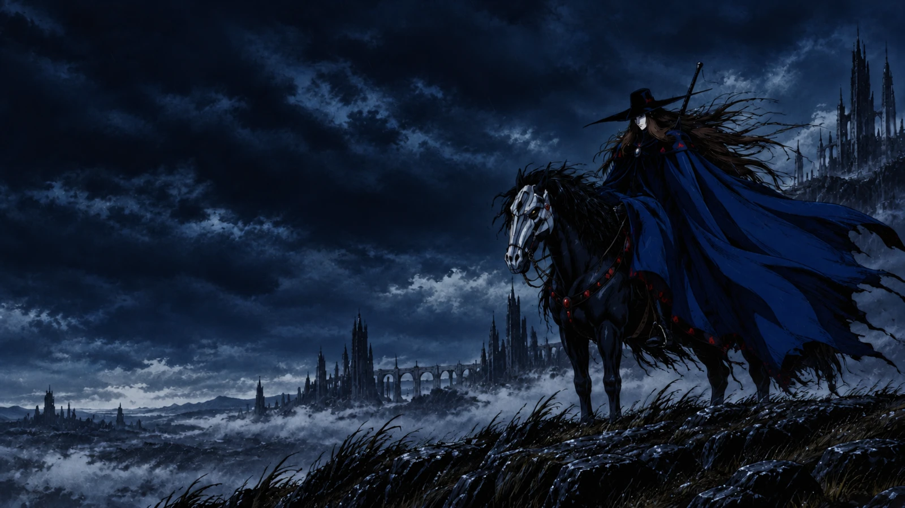
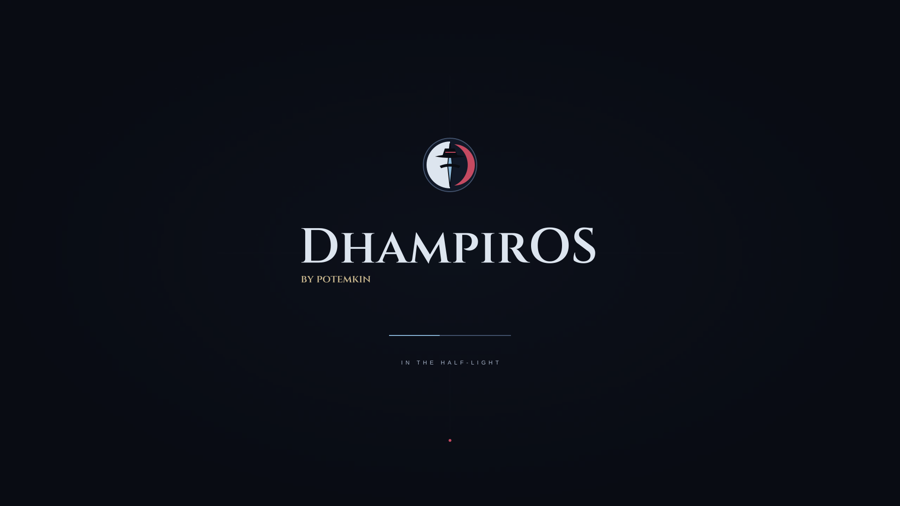
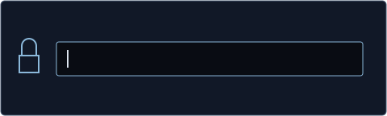
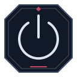
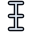
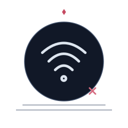
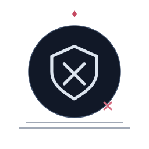
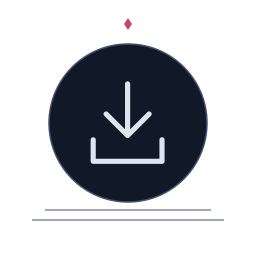
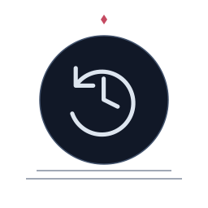

 

# DhampirOS

**A hardened Kicksecure derivative dressed for the night.**

<a href="https://potemkin666.github.io/DhampirOS/#icons"><b>✦ EXPLORE THE INTERACTIVE DESKTOP ✦</b></a>

Move windows, browse Files, change the wallpaper and explore the login, setup and icon previews. Original project artwork with a quiet 24-second motion loop. Interactive visual study; experimental alpha images are now available.

  

&nbsp;&nbsp;&nbsp;&nbsp;
&nbsp;&nbsp;&nbsp;&nbsp;

---

## Boot identity

Supplied design asset. Concept artwork, not a runtime screenshot.

  

---

## System icon language

Examples from the supplied DhampirOS icon theme.

---

## Cursor set

&nbsp;&nbsp;
&nbsp;&nbsp;
&nbsp;&nbsp;
&nbsp;&nbsp;
&nbsp;&nbsp;
&nbsp;&nbsp;
&nbsp;&nbsp;

---

## Session language

 

---

## Installer stages

<table>
<tr>
<td align="center"> WELCOME</td>
<td align="center">→</td>
<td align="center"> STORAGE</td>
<td align="center">→</td>
<td align="center"> USERS</td>
<td align="center">→</td>
<td align="center"> INSTALL</td>
<td align="center">→</td>
<td align="center"> FINISHED</td>
</tr>
</table>

---

## System states

---

### Current state

| | Component | State |
|---|---|---|
| ✓ | `dhampir-lxqt` derivative flavour | wired |
| ✓ | `dhampiros-artwork` Debian package | builds |
| ✓ | LXQt / icon / wallpaper / QTerminal defaults | initialized in the image accounts |
| ✓ | runtime visual smoke test | native motion CI; real desktop captures reviewed |
| ◇ | GRUB theme enabled by default | pending runtime verification |
| ✓ | AMD64 ISO / OVA | built and checked for alpha 0.1.0 |
| ◇ | custom Dhampir kernel | not started |

> **Experimental alpha.** The full ISO and OVA reached the Dhampir desktop in network-isolated BIOS and UEFI KVM tests. The exact public OVA also passed reviewed BIOS/UEFI boots in VirtualBox 7.2.22 on Linux ([runtime evidence](https://github.com/potemkin666/DhampirOS/releases/download/v0.1.0-alpha.1/virtualbox-runtime-report.json)). Both images also passed [enforcing Secure Boot VM checks](https://github.com/potemkin666/DhampirOS/releases/download/v0.1.0-alpha.1/secure-boot-hardware-report.json), including an unsigned-loader rejection control and kernel integrity lockdown. The extra `tirdad` module was not loaded in those sessions. Physical hardware remains untested. These images are for isolated VM testing. Unresolved upstream tracker findings and other verification limits remain; this is not a security certification or a production-ready release.

Build details live in [`agents/BUILD.md`](agents/BUILD.md). DhampirOS is an independent project based on Kicksecure/Debian and is not endorsed by the Kicksecure or Whonix developers.

See [`COPYING`](COPYING) for licensing; individual bundled assets retain their applicable notices and provenance.
