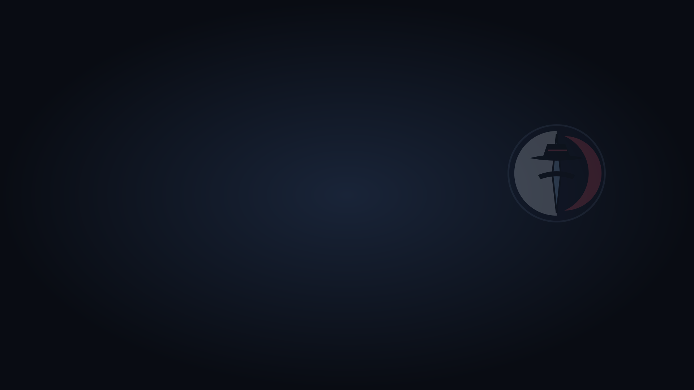
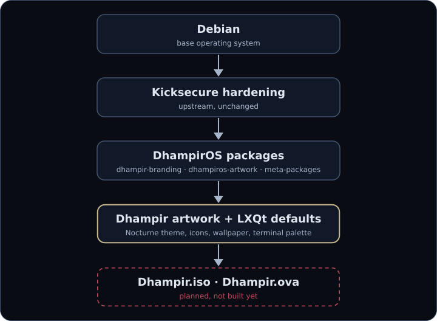
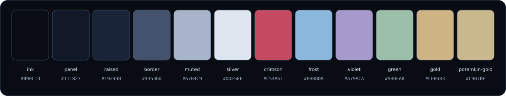

 

# DhampirOS

**A hardened Kicksecure derivative dressed for the night.**

 

  

  

  

<table>
  <tr>
    <th>HARDENED BASE</th>
    <th>DHAMPIR LXQT</th>
    <th>CUSTOM ARTWORK</th>
  </tr>
  <tr>
    <td><b>Kicksecure</b></td>
    <td><b>Nocturne</b></td>
    <td><b>GRUB / icons / wallpaper</b></td>
  </tr>
  <tr>
    <td>Upstream hardening, left unchanged.</td>
    <td>Dark desktop and terminal defaults for new users.</td>
    <td>Dhampir artwork shipped as one Debian package.</td>
  </tr>
</table>

  

## Status

- ✓ Dhampir derivative flavour
- ✓ Dhampir artwork Debian package
- ✓ LXQt defaults
- ✓ icon theme
- ✓ wallpaper
- ✓ QTerminal palette
- ◇ GRUB theme installed but not yet enabled by default
- ◇ OVA not yet built
- ◇ ISO not yet built
- ◇ custom kernel not started

✓ = implemented in this repository. Nothing has been runtime-tested yet.

Build details: [agents/BUILD.md](agents/BUILD.md)

---

DhampirOS is an independent project, not made or endorsed by the Kicksecure or Whonix developers.
 
Code: AGPL-3.0-or-later, see [COPYING](COPYING). Upstream files keep their own licences.

