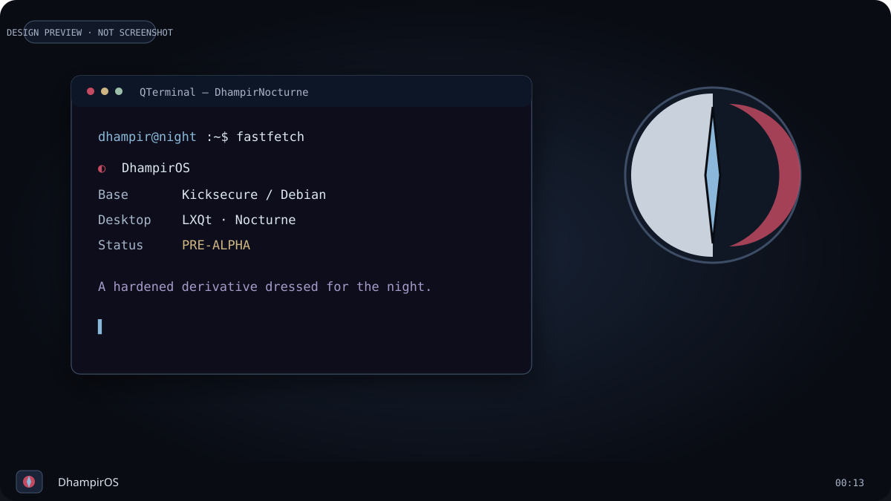
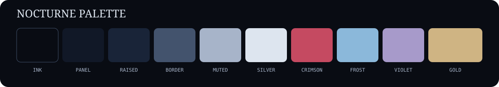
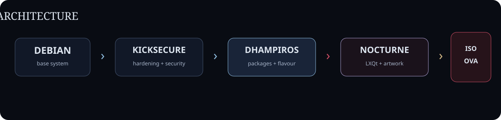

 

# DhampirOS

**A hardened Kicksecure derivative dressed for the night.**

 
 

---

## Visual direction

Design preview only. Not a runtime screenshot.

  

---

## Architecture

---

<table>
<tr>
<td align="center" width="33%"><b>HARDENED BASE</b>  Kicksecure security packages and hardening remain the foundation.</td>
<td align="center" width="33%"><b>DHAMPIR LXQt</b>  Nocturne LXQt defaults, icon identity and QTerminal styling.</td>
<td align="center" width="33%"><b>CUSTOM ARTWORK</b>  Dhampir wallpaper, sigil, GRUB theme and visual system.</td>
</tr>
</table>

---

### Current state

| | Component | State |
|---|---|---|
| ✓ | `dhampir-lxqt` derivative flavour | wired |
| ✓ | `dhampiros-artwork` Debian package | wired |
| ✓ | LXQt / icon / wallpaper / terminal defaults | implemented for new users |
| ◇ | GRUB theme | shipped, not yet enabled by default |
| ◇ | `Dhampir.ova` | not yet built |
| ◇ | `Dhampir.iso` | not yet built |
| ◇ | custom Dhampir kernel | not started |

> **Pre-alpha:** no complete Dhampir ISO or OVA has yet been built and runtime-verified end to end.

### Build

Build notes and exact commands live in [`agents/BUILD.md`](agents/BUILD.md).

DhampirOS preserves Kicksecure's security layer and adds its own derivative, packaging, defaults and visual identity on top. It is an independent project and is not made by or endorsed by the Kicksecure or Whonix developers.

### Licence

See [`COPYING`](COPYING). Upstream files retain their original licences and notices.
